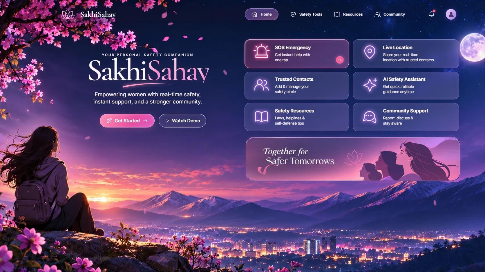
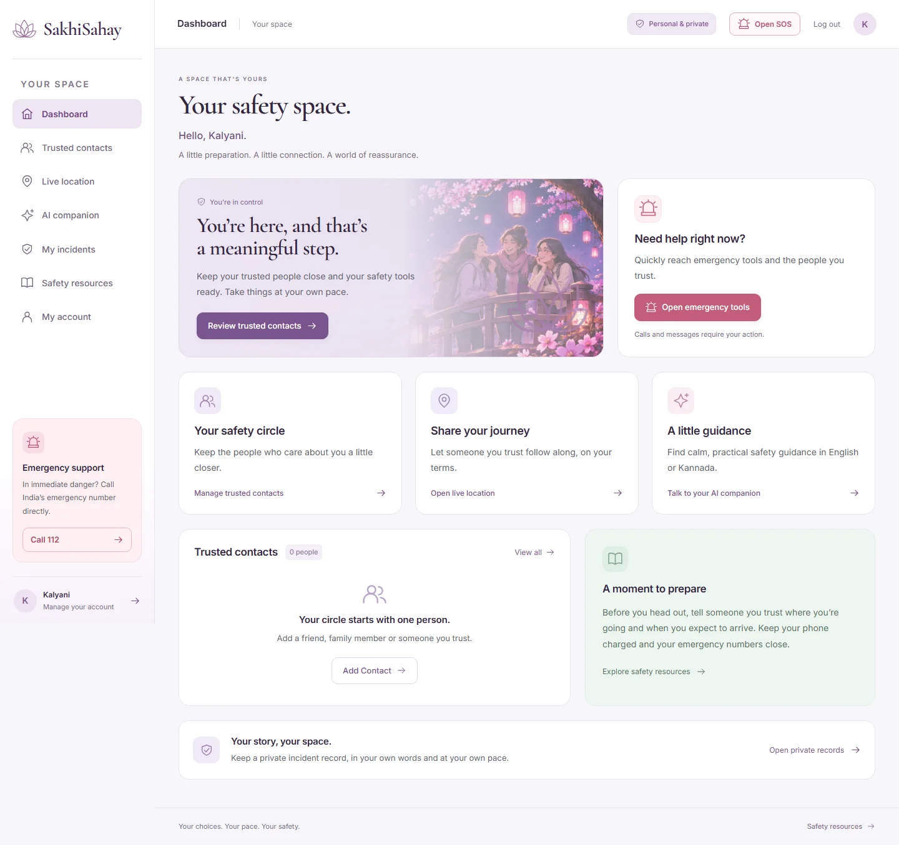
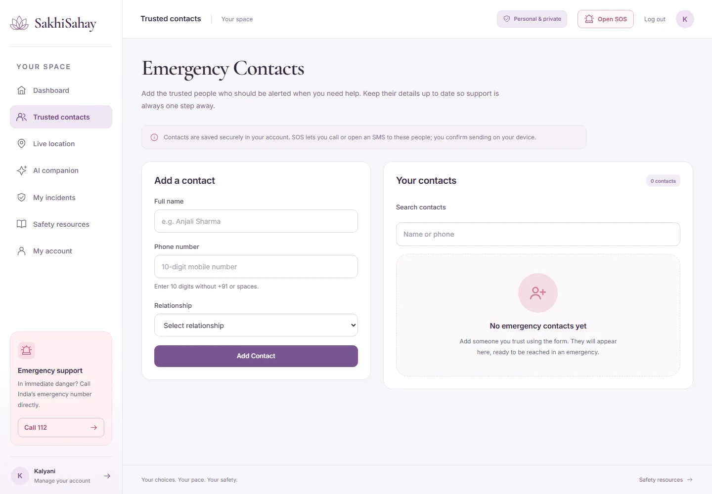
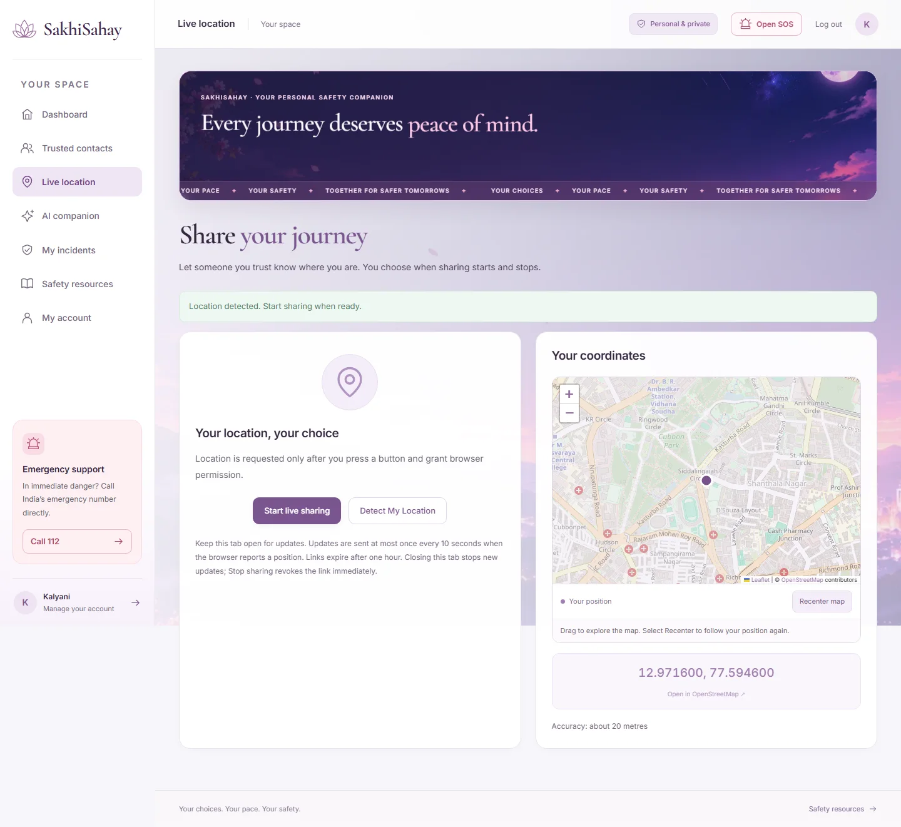
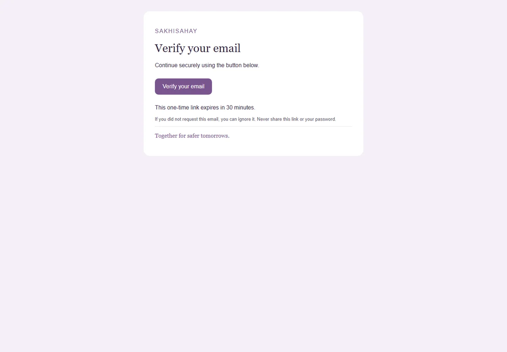
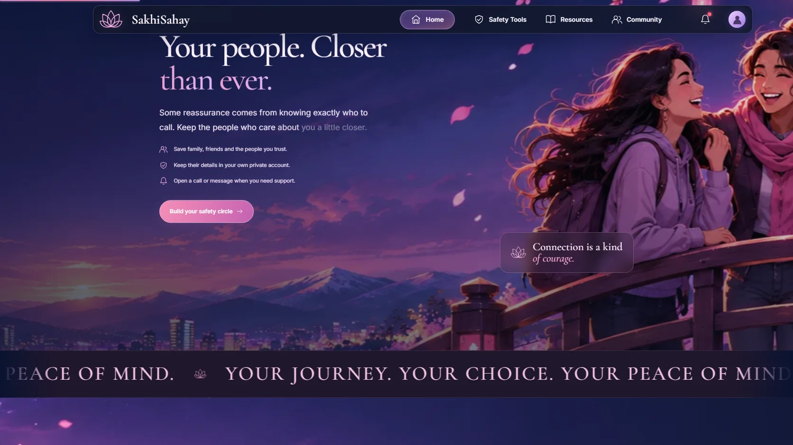
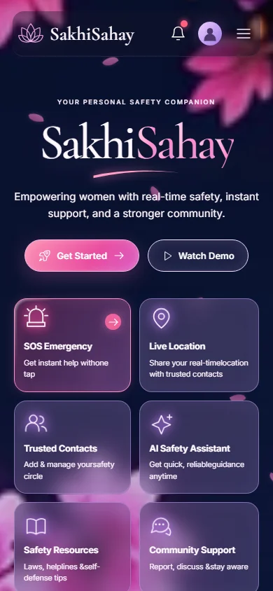
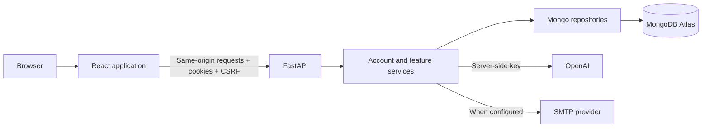

# SakhiSahay

### Your personal safety companion — together for safer tomorrows.

[Open the live application](https://sakhisahay-9059.vercel.app) · [Browse the source](https://github.com/9059Rohith/SAKHISAHAY) · [API contract](docs/API_CONTRACT.md) · [Deployment guide](docs/DEPLOYMENT.md) · [Verification report](docs/FINAL_REPORT.md)



SakhiSahay brings trusted contacts, private location sharing, practical AI guidance, private incident records and emergency contact actions into one personal space. It completes the original React frontend with a real FastAPI backend, MongoDB Atlas persistence, secure account sessions and server-side OpenAI integration.

The homepage follows the supplied cherry-blossom illustration reference: navy skies, rose and violet accents, translucent glass panels, fourteen optimized illustrations and six homepage sections. Strong layered parallax, floating title letters, repeatable word reveals, scroll-linked paragraph highlighting and moving typography animate the homepage. Inside the application, a modern light workspace pairs the same lotus branding and serif headings with white cards, deep plum text, a lavender canvas and clear navigation.

> Emergency services are not automatically dispatched. Call and SMS controls open the device's native apps and require the user to confirm sending. Private incident records are personal records, not official police complaints. In immediate danger in India, call 112.

## Contents

1. [Features](#features)
2. [Visual experience](#visual-experience)
3. [Screens and routes](#screens-and-routes)
4. [Technology and architecture](#technology-and-architecture)
5. [Local setup](#local-setup)
6. [Environment configuration](#environment-configuration)
7. [Administrator access](#administrator-access)
8. [API reference](#api-reference)
9. [Database and migrations](#database-and-migrations)
10. [Testing and verification](#testing-and-verification)
11. [Deployment](#deployment)
12. [Backup and recovery](#backup-and-recovery)
13. [Security](#security)
14. [Troubleshooting](#troubleshooting)
15. [Project structure](#project-structure)
16. [External services and limitations](#external-services-and-limitations)

## Features

| Feature | What works |
| --- | --- |
| Accounts | Register, sign in, sign out, profile editing, password changes, account lockout and one-time recovery codes |
| Sessions | Short-lived access cookies, rotating refresh cookies, durable family revocation and cross-tab refresh coordination |
| Trusted contacts | Save, search, edit and remove contacts; records remain after refresh and sign-in |
| AI companion | Real OpenAI responses, English/Kannada selection, suggested questions, saved conversation history and history deletion |
| Live location | Explicit browser consent, interactive OpenStreetMap, private one-hour links, position updates, public viewer and immediate link revocation |
| Incident records | Private records with category/date/location/description, search, status filtering, edit, delete and JSON export |
| Emergency SOS | Idempotent saved alerts, contact call/SMS buttons, shareable alert messages, location snapshots and resolution history |
| Resources | Public safety guidance and official external support resources |
| Administration | Server-protected aggregate counts; private incident descriptions and conversations are not exposed in the summary |
| Operations | Health/readiness/version endpoints, structured errors, migrations, logical backup/restore tools and deployment configuration |

Email verification and email-based password recovery are implemented behind configurable SMTP. The deployed app provides saved recovery codes independently of email delivery. See [external services](#external-services-and-limitations) for infrastructure that is not provisioned.

## Visual experience

The homepage has six sections, each with a distinct illustrated background:

1. **The reference hero:** animated SakhiSahay title and six functional safety-tool cards.
2. **Your safety circle:** trusted people, private contact management and connection.
3. **A shared journey:** consent, private links and user-controlled location sharing.
4. **A little guidance:** the AI companion and questions that open prefilled in chat.
5. **Feel prepared:** illustrated resource cards leading to guidance, incident records and SOS.
6. **Safer tomorrows:** the closing invitation, account access and resource footer.

The image inventory includes distinct account, dashboard, contacts, location, chat, incident and SOS illustrations. Every inner workspace now has its own illustrated backdrop and scenic banner, including account/admin pages and the shared-location viewer. Working forms use clear light surfaces over the scenery to keep text readable. Artwork is encoded as WebP; below-fold homepage illustrations load lazily.

Motion includes:

- Strong independent background travel and foreground counter-motion while scrolling.
- Pointer-driven depth in the hero, with separate background, title and card movement.
- Floating title characters, glowing icons and drifting petals.
- Repeatable word entrances when headings leave and re-enter the viewport.
- Word-by-word paragraph emphasis linked to scroll progress.
- Faster scrolling text bands and gently moving resource artwork.
- Sticky translucent navigation and a scroll-progress indicator.

The homepage uses a compact **80% layout scale** on wide desktop screens, approximating two Ctrl-minus presses. Inner application forms and mobile pages use normal scale for readability. Actual browser zoom is controlled by the browser and can still be adjusted independently. The app respects `prefers-reduced-motion`: movement stops and all text remains visible.

### Modern application workspace

The approved homepage is preserved. The inner application has a shared sidebar, active page navigation, a persistent SOS shortcut, real account information and responsive cards. The dashboard shows actual contact data with loading, error and empty states. Login and registration pair a scenic illustration with readable forms. Contacts, chat, records, resources, profile and administration share the same palette and typography. On phones, the menu traps keyboard focus while open, closes on Escape, and returns focus to its trigger; its hidden links are inert.

Inner pages also feature route-specific illustrated backgrounds with scroll parallax, independent banner depth and pointer movement, drifting petals, floating title words, continuous scrolling text and repeatable animated page headings. Account artwork moves too. Motion updates are scheduled with requestAnimationFrame and listeners are cleaned up on route changes; reduced-motion mode stops the movement and keeps all headings visible. Forms, emergency actions and map controls remain stationary. The SOS banner is compact and omits the text ticker to keep emergency tools easy to reach.





### Interactive OpenStreetMap

Location detection and active shared-location links render a real Leaflet 1.9.4 map with OpenStreetMap tiles, position marker, accuracy circle, drag/zoom controls, visible attribution and a Recenter action. Detecting a position alone does not publish it. Shared viewers receive only the position authorized by the private expiring link. Revocation and expiration also stop access to the position API.

Map tiles are an external service. If they cannot load, the application keeps coordinates and an external map link available. The tile request sends only the site origin as its referrer, excluding the private share-token path. Standard tiles are best-effort infrastructure, with no offline downloads or prefetching; follow the [OpenStreetMap tile usage policy](https://operations.osmfoundation.org/policies/tiles/) and configure a suitable provider for higher traffic. `VITE_OSM_TILE_URL` can override the tile template; allow any alternative provider in the deployed image Content Security Policy too.



### Connecting SMTP

Email verification and recovery use the server-side SMTP adapter. Set `SMTP_HOST`, `SMTP_PORT`, `SMTP_USER`, `SMTP_PASSWORD` and `EMAIL_FROM` in the hosting environment, then redeploy. `SMTP_SECURITY=auto` uses TLS on port 465 and mandatory STARTTLS on other ports. Use `tls` or `starttls` for a provider-specific custom port; `none` is limited to local development and is rejected in production. TLS certificates are validated. Configure the sender/domain with the mail provider and test delivery to an inbox you control. Credentials belong only in server environment settings. No SMTP provider credentials were supplied, so public email delivery remains blocked; saved recovery codes work independently.

When SMTP is configured, registration sends a branded multipart verification email automatically and reports whether it was sent. An email outage does not discard the new account; verification can be resent from My account. Confirming an email link immediately refreshes the signed-in profile, and verified accounts cannot resend unnecessary verification messages. Forgot-password requests preserve account privacy. If mail delivery is globally unconfigured, both known and unknown addresses receive the same explicit unavailable response.

Verification and reset links expire after 30 minutes and can be used once. Failed sends invalidate their newly issued tokens. Password reset requires matching confirmation, hides an emailed token from visible form fields, clears local session cookies and revokes all sessions plus pending reset links. Administrator-only `GET /api/v1/admin/email-status` reports configuration flags and transport without exposing mail credentials; it does not certify inbox delivery.

Tests in `backend/tests/test_email_delivery.py` send through an actual loopback SMTP socket. A separate browser check against an isolated Atlas database exercised registration → received message → verification → profile refresh → forgot password → received reset link → new-password sign-in. These are local integration proofs, not evidence of delivery through a public provider. See [the SMTP activation guide](docs/SMTP_SETUP.md).





<details>
<summary>Mobile layout preview</summary>



</details>

## Screens and routes

| Route | Access | Purpose |
| --- | --- | --- |
| `/` | Public | Six-section illustrated homepage and walkthrough |
| `/register` | Public | Create an account |
| `/login` | Public | Sign in |
| `/forgot-password` | Public | Request an email recovery link when SMTP is configured |
| `/reset-password` | Public | Reset with a valid recovery code or email token |
| `/verify-email` | Public token | Confirm a verification email |
| `/recovery-code` | Signed in | Display a newly issued one-time recovery code |
| `/dashboard` | Signed in | Personal welcome, contacts and safety tools |
| `/emergency-contacts` | Signed in | Trusted-contact management |
| `/location` | Signed in | Detect, share and revoke location links |
| `/share/:token` | Capability link | View an active shared position |
| `/chatbot` | Signed in | English/Kannada AI safety guidance |
| `/reporting` | Signed in | Private incident records and reporting resources |
| `/safety-information` | Public | Safety information and guidance |
| `/profile` | Signed in | Profile, password and sign-out controls |
| `/admin` | Administrator | Aggregate operational summary |

Unknown routes render a dedicated page-not-found screen. Protected routes redirect to sign-in; the backend independently enforces authorization.

## Technology and architecture

| Layer | Implementation |
| --- | --- |
| UI | React 19, JSX, React Router 7 |
| Frontend build | Vite 8, npm lockfile, self-hosted Inter and Cormorant Garamond |
| Animation | CSS keyframes, IntersectionObserver, requestAnimationFrame and passive scroll listeners |
| Maps | Dynamically loaded Leaflet 1.9.4, OpenStreetMap tiles and origin-only tile referrers |
| API | FastAPI on Python 3.12; explicit Pydantic request/response models |
| Database | MongoDB Atlas with Motor; unique, compound and TTL indexes |
| Authentication | Argon2, signed access tokens and hashed rotating refresh tokens |
| AI | Server-side OpenAI Chat Completions; model configured through the environment |
| Email | Configurable asynchronous SMTP with retry and text/HTML templates |
| Hosting | Vercel static frontend plus Python API function in Mumbai (`bom1`) |
| Verification | pytest/coverage, Vitest/Testing Library, Playwright, Ruff, Black, mypy and dependency audits |



Only the server accesses database and AI credentials. Mongo queries live in the repository layer. Services implement account/resource rules. The HTTP layer validates input and returns explicit public schemas. Read [ARCHITECTURE.md](docs/ARCHITECTURE.md) for the authentication and sharing flows.

## Local setup

### Requirements

- Python **3.12**.
- Node.js **24** and npm.
- A reachable MongoDB instance or MongoDB Atlas connection.
- An OpenAI key with access to the configured model for real AI responses.
- A modern browser; live geolocation requires HTTPS or localhost and browser permission.

### Windows / PowerShell

```powershell
git clone https://github.com/9059Rohith/SAKHISAHAY.git
cd SAKHISAHAY
python -m venv .venv
.\.venv\Scripts\Activate.ps1
Copy-Item backend/.env.example backend/.env
python -m pip install -r backend/requirements-dev.txt
npm --prefix frontend ci
```

Edit `backend/.env` privately, then provision indexes and start the API:

```powershell
python -m scripts.migrate
python -m uvicorn backend.app.main:app --host 127.0.0.1 --port 8000 --no-access-log
```

In a second terminal, from the repository root:

```powershell
npm --prefix frontend run dev
```

Open **http://localhost:5173**. Register and save the one-time recovery code securely. Development API documentation is available at **http://127.0.0.1:8000/docs**.

### macOS / Linux

```bash
git clone https://github.com/9059Rohith/SAKHISAHAY.git
cd SAKHISAHAY
python3.12 -m venv .venv
source .venv/bin/activate
cp backend/.env.example backend/.env
pip install -r backend/requirements-dev.txt
npm --prefix frontend ci
python -m scripts.migrate
python -m uvicorn backend.app.main:app --host 127.0.0.1 --port 8000 --no-access-log
```

Start the frontend in a second terminal with `npm --prefix frontend run dev`.

### Docker alternative

After creating the environment file:

```sh
docker compose up --build
```

The development frontend is exposed on port 5173 and the API on port 8000. Mongo is available internally to the compose services. `docker-compose.prod.yml` supplies the production container alternative; configure an external HTTPS reverse proxy and production host/origin variables before using it.

The local Docker engine was unavailable during implementation, so the container configuration is supplied without a local Docker execution claim. The live Vercel application was tested directly.

## Environment configuration

Copy the commented examples rather than putting credentials in code:

- [`backend/.env.example`](backend/.env.example): all server settings.
- [`frontend/.env.example`](frontend/.env.example): public API base path only.

| Variable | Purpose |
| --- | --- |
| `APP_ENV` | `development`, `test`, `staging` or `production` |
| `SECRET_KEY` | Random signing secret; production requires at least 64 characters |
| `MONGODB_URI` | Private MongoDB connection string |
| `MONGODB_DB_NAME` | Application database; use a separate test/staging database |
| `OPENAI_API_KEY` | Server-only AI credential |
| `OPENAI_MODEL` | Accessible model, currently `gpt-4.1-mini` |
| `FRONTEND_URL` | Absolute frontend URL for email links; HTTPS in production |
| `CORS_ORIGINS` | Comma-separated explicit allowed origins |
| `ALLOWED_HOSTS` | Trusted request hostnames |
| `RATE_LIMIT_ENABLED` | Enable database-backed request limits |
| `SMTP_HOST`, `SMTP_PORT` | Optional transactional mail server |
| `SMTP_USER`, `SMTP_PASSWORD`, `EMAIL_FROM` | Optional mail authentication and sender |
| `FIRST_ADMIN_EMAIL`, `FIRST_ADMIN_PASSWORD` | Private first-admin provisioning inputs |
| `GIT_SHA`, `BUILD_TIME` | Deployment/version metadata |
| `VITE_API_BASE_URL` | Public frontend API path, normally `/api/v1` |

Generate a signing secret locally:

```sh
python -c "import secrets; print(secrets.token_hex(48))"
```

Production refuses unsafe signing secrets, debug mode, wildcard CORS and a non-HTTPS frontend URL. Never place an OpenAI key, MongoDB URI or password in a `VITE_` variable. Real environment files and the `private/` directory are ignored by Git.

## Administrator access

Administrator credentials are provisioned privately in MongoDB. Passwords are stored as Argon2 hashes. Public registration cannot assign an administrator role.

1. Open `/login` and sign in with the credentials supplied privately by the project owner.
2. Open `/profile`; administrator accounts have an **Administration** link.
3. Visit `/admin` to view aggregate account/contact/report/alert counts.

For a new installation, set `FIRST_ADMIN_EMAIL` and `FIRST_ADMIN_PASSWORD` privately and run:

```sh
python -m scripts.seed
```

Production seeding requires the explicit `--force` flag. The script is idempotent and refuses to silently promote an existing normal account. It does not add fake users, incidents, contacts or emergencies. Keep recovery codes and administrative passwords out of this README and GitHub history.

## API reference

Base path: `/api/v1`. The frontend uses one central client with cookies, CSRF headers, request timeouts, structured errors and coordinated refresh.

| Resource | Main operations |
| --- | --- |
| `/auth` | Signup, login, logout, me, refresh, change/reset password and email verification |
| `/users/me` | Update public profile fields |
| `/contacts` | Paginated/searchable list, create, edit and delete |
| `/reports` | Paginated/searchable/filterable private incident CRUD |
| `/chat/messages` | Conversation history, real AI question/answer and history deletion |
| `/location-shares` | Create, update, list and revoke owned shares |
| `/location-shares/public/{token}` | Read an active capability-protected position |
| `/alerts` | Idempotent SOS creation, history and resolution |
| `/admin/summary` | Administrator-only aggregate counts |

Operations endpoints are public `/health`, `/ready` and `/version`. Interactive API documentation is disabled in production. Exported schemas remain in the repository:

- [API contract](docs/API_CONTRACT.md).
- [OpenAPI JSON](docs/openapi.json).
- [Postman collection](docs/postman.json).

Regenerate exports after changing API schemas:

```sh
python -m scripts.export_api
```

List endpoints return `items`, `total`, `page`, `page_size` and `pages`. Page sizes are capped at 100. Mutations validate strict schemas and reject unknown fields. Errors use a consistent envelope:

```json
{
  "error": {
    "code": "VALIDATION_ERROR",
    "message": "Check the highlighted fields and try again",
    "details": [],
    "request_id": "correlation-id"
  }
}
```

Owned records always include the current user in database queries. Another user's identifier does not grant access to their record.

## Database and migrations

Collections include `users`, `session_families`, `refresh_tokens`, `password_resets`, `contacts`, `reports`, `chat_messages`, `location_shares`, `alerts`, `audit_logs`, `rate_limits` and migration records.

Unique indexes protect email addresses, owner/phone pairs, token hashes, session families and alert idempotency keys. TTL indexes expire refresh/reset/share/family records and rate-limit buckets. Authorization also checks expiry immediately; it does not wait for Mongo's asynchronous TTL cleanup.

Run migrations explicitly before a release:

```sh
python -m scripts.migrate
```

Production cold starts do not repeat every index-creation command. This avoids unnecessary serverless startup latency. [DATA_MODEL.md](docs/DATA_MODEL.md) describes document shapes, while [QUERY_PLAN_EVIDENCE.json](docs/QUERY_PLAN_EVIDENCE.json) records actual indexed owner-list plans.

## Testing and verification

```sh
python -m pytest --cov=backend/app --cov-fail-under=85
python -m ruff check backend
python -m black --check backend api
python -m mypy backend/app
npm --prefix frontend test
npm --prefix frontend run lint
npm --prefix frontend run typecheck
npm --prefix frontend run format:check
npm --prefix frontend run build
npm --prefix frontend run test:e2e
```

Backend tests cover authentication, lockout, refresh rotation/replay/concurrency, CSRF, input validation, ownership isolation, CRUD, optimistic versions, expiry/revocation, alert idempotency, provider failures and database outages. Backend unit/integration tests use an injected Mongo-compatible test database. Full browser tests use the actual running stack; local verification used a separate Atlas E2E database and real OpenAI.

The browser suite covers the six sections, image loading, walkthrough, mobile menu, reduced motion, registration, contact persistence/edit/delete, incident persistence/edit, real AI history, private share viewing/revocation, SOS resolution, logout and recovery. Dedicated motion checks verify strong image movement, desktop 80% scale, mobile normal scale and absence of horizontal overflow/runtime errors.

To target a deployment in PowerShell:

```powershell
$env:E2E_BASE_URL='https://YOUR_DEPLOYMENT.vercel.app'
npm --prefix frontend run test:e2e
```

Use an isolated environment for routine E2E runs. Tests create synthetic accounts and records and require a working configured AI provider. Current verification includes **44 backend tests**, **12 frontend unit tests** and **4 browser tests** covering the homepage, mobile keyboard/long-name behavior, inner parallax/reduced motion, and the real account/contacts/incidents/OpenAI/live-share/SOS/recovery workflow. Seven backend email tests include SMTP socket delivery and slow-provider/failure cases. Previous coverage was approximately 98.6%; coverage has not been re-certified for every new email branch. Consult the delivery report for the latest deployed results and any checks that are not certified complete.

## Deployment

The live stack is Vercel static hosting plus a Python API function, using MongoDB Atlas and server-only encrypted AI/database variables. Vercel's production hostname is linked at the top of this README.

Release sequence:

1. Run the checks and production build.
2. Run database migrations against the intended database.
3. Commit and push sanitized source.
4. Deploy the exact commit to the connected Vercel project.
5. Confirm the deployment is `READY`.
6. Run health/readiness/version checks and the real browser flow.

```sh
python -m scripts.healthcheck https://YOUR_DEPLOYMENT.vercel.app
```

`vercel.json` defines Python/static builders, monorepo asset rewrites, SPA fallback, security headers and Mumbai function placement. Python dependencies are declared in `pyproject.toml`; pinned requirements files are also provided.

**CI/CD permission limitation:** the GitHub OAuth credential used during setup lacks the `workflow` scope. Complete workflow definitions are preserved under [docs/workflow-templates](docs/workflow-templates). Activate them from a GitHub session/token with workflow permission. The CD template additionally requires Vercel deployment credentials and a protected production GitHub Environment. No green CI or automatic deployment/rollback claim is made without those active runs.

See [DEPLOYMENT.md](docs/DEPLOYMENT.md) for environment setup, alternative hosting, troubleshooting and rollback instructions. Use Vercel's previous verified deployment promotion for code rollback; do not automatically overwrite the database when rolling back code.

## Backup and recovery

Create a BSON-preserving logical gzip backup:

```sh
python -m scripts.backup backup --file private/backups/latest.json.gz
```

Restore into a **new empty database**:

```sh
python -m scripts.backup restore --file private/backups/latest.json.gz --database NEW_EMPTY_DATABASE --confirm-restore
```

The restore command refuses nonempty targets. Backups contain sensitive account/incident data: store them privately, encrypt them at rest and keep them off GitHub. Shell alternatives using `mongodump`/`mongorestore` are also supplied.

A complete logical drill restored 66 synthetic E2E documents across 11 collections with matching counts; the temporary restore database was removed afterward. See [BACKUP_RESTORE_PROOF.md](docs/BACKUP_RESTORE_PROOF.md). This does not claim automatic Atlas backup scheduling or point-in-time recovery is configured.

## Security

- Argon2 password hashing and no plaintext password storage.
- Secure, httpOnly, SameSite session cookies in production.
- CSRF and Origin checks for mutations.
- Strict Pydantic input models and explicit public response schemas.
- Owner-scoped database operations and server-side role checks.
- Account lockout and shared database-backed request limits.
- Durable refresh-family revocation, including concurrent replay protection.
- Random share/reset/refresh capabilities stored as hashes.
- Strong production environment validation, security headers and same-origin CSP.
- No API keys in frontend bundles, repository source or README examples.
- Explicit provider errors instead of fake AI replies or false emergency-delivery claims.

Read [SECURITY.md](docs/SECURITY.md) for the threat model, verified controls and external administrative requirements.

## Troubleshooting

| Symptom | Check |
| --- | --- |
| API returns 503 | Atlas connectivity, credentials, allow-list and service availability |
| AI cannot respond | OpenAI key, accessible model, billing/quota and provider availability |
| Location is unavailable | HTTPS/localhost, browser permission and device location settings |
| Shared position looks old | Sender tab may be closed or offline; check last-update time |
| Share link no longer works | It may be revoked or past its one-hour expiry |
| Email does not arrive | SMTP configuration, provider delivery and domain authentication |
| Session expires | Sign in again; revoked/replayed sessions intentionally stop working |
| Readiness is slow after deployment | Confirm migrations were run separately from request startup |
| Frontend route returns 404 | Check SPA/monorepo rewrites in vercel.json |
| Function import error | Check pyproject.toml dependency installation |
| Animations do not move | Check the device/browser reduced-motion preference |
| Desktop appears smaller | The requested compact 80% desktop layout is active; browser zoom is separate |

For recovery, logs, credential rotation and deployment rollback, see [RUNBOOK.md](docs/RUNBOOK.md).

## Project structure

```text
SAKHISAHAY/
├── api/index.py                 Vercel Python entrypoint
├── backend/
│   ├── app/
│   │   ├── core/                Settings, security and errors
│   │   ├── services/            Accounts, safety features and mail
│   │   ├── repositories.py      Mongo queries and indexes
│   │   ├── schemas.py           Strict request/public response models
│   │   ├── api.py               Versioned HTTP endpoints
│   │   └── main.py              Application, middleware and operations
│   ├── tests/                   Backend tests and failure/race coverage
│   └── .env.example             Commented private configuration template
├── frontend/
│   ├── src/components/          Motion, sections, shared UI and incidents
│   ├── src/lib/                 Central API client and account provider
│   ├── src/pages/               Existing and integrated app screens
│   ├── src/styles/              Night, story, expressive motion and page styles
│   ├── public/images/           Fourteen optimized illustrations
│   └── e2e/                     Real browser application tests
├── docs/                        Audit, contracts, screenshots and evidence
├── scripts/                     Migration, backup, restore, seed and checks
├── nginx/                       Container reverse proxy configuration
├── docker-compose*.yml          Alternative local/container deployments
├── pyproject.toml               Python runtime dependencies and quality tools
├── vercel.json                  Hosting builders, routes and headers
└── README.md
```

## External services and limitations

The hosted application's core account, contact, incident, AI, sharing and SOS-action flows are implemented and tested. The following require additional provider/infrastructure setup or separate verification: real transactional email/domain authentication, automatic SMS delivery, custom DNS, independent uptime/error alerts, scheduled encrypted production backups/PITR, formal high-concurrency load testing, ZAP/Lighthouse certification and active GitHub workflows.

These are described explicitly in [FINAL_REPORT.md](docs/FINAL_REPORT.md); the entire enterprise operational checklist from the original brief is not represented as universally complete. AI guidance can make mistakes and is not a substitute for emergency services or professional advice.

## Credits and documentation

Original frontend: [Bhavanakn-06/SAKHISAHAY](https://github.com/Bhavanakn-06/SAKHISAHAY). The application retains its React framework. Illustrations were generated from the user-supplied visual direction and optimized for web delivery. No license grant is inferred for original material that did not include one.

Further reading: [frontend audit](docs/FRONTEND_AUDIT.md), [assumptions](docs/ASSUMPTIONS.md), [visual specification](docs/UI_SPEC.md), [performance notes](docs/PERFORMANCE.md), [changelog](CHANGELOG.md).
